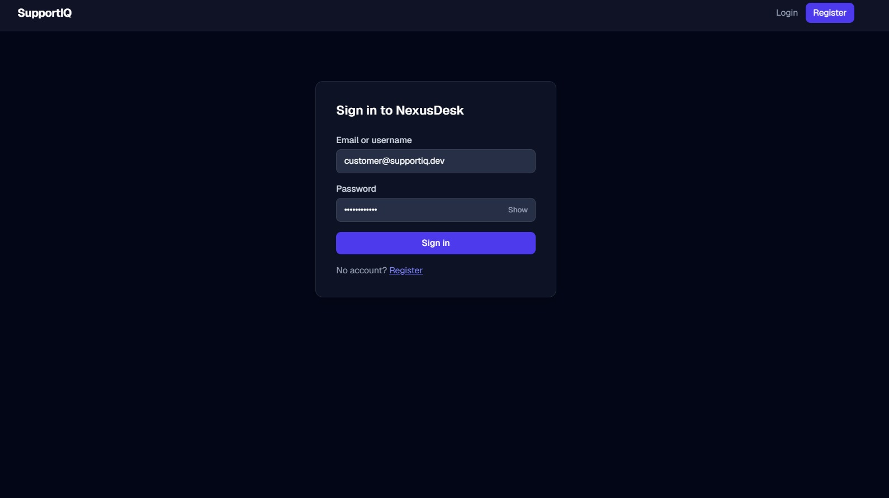
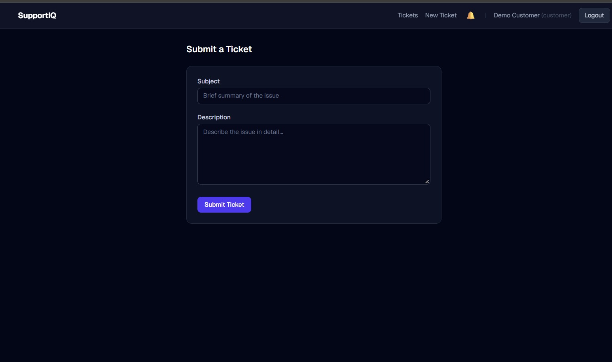
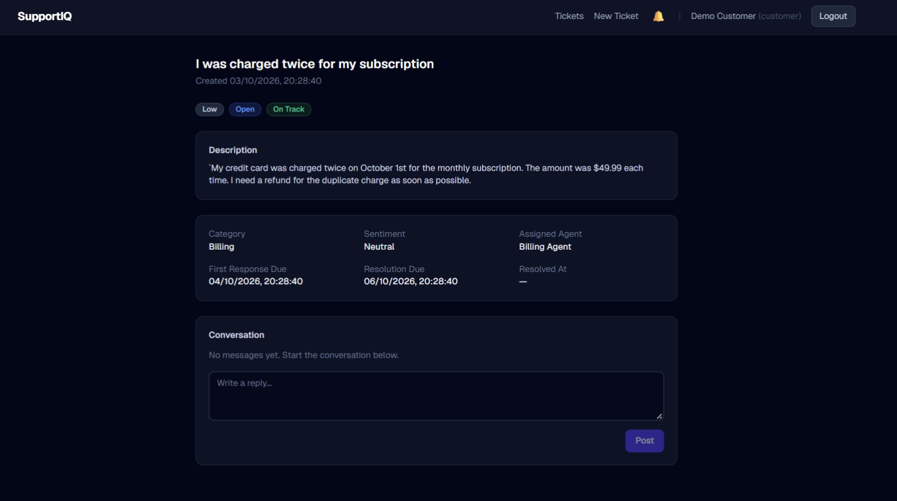
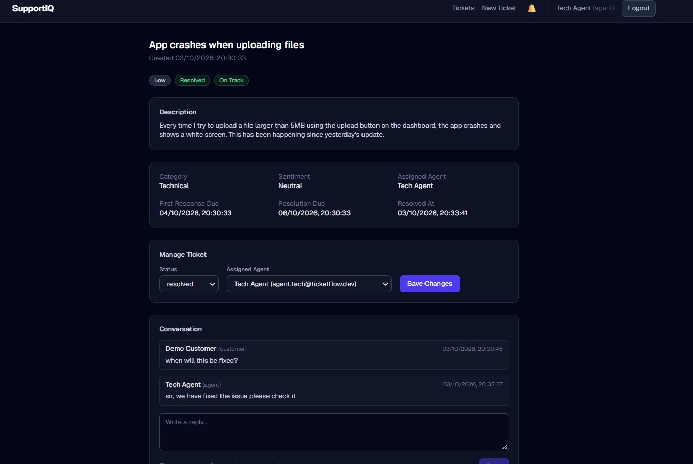
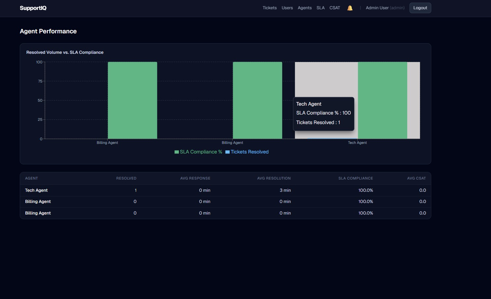
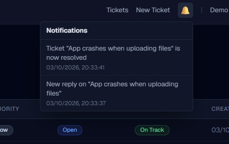

#  SupportIQ

**An AI-powered helpdesk that automatically categorizes, prioritizes, and routes support tickets, while giving admins live SLA and CSAT analytics.**


---

## 📖 About

SupportIQ is a full-stack customer support ticketing system. Customers submit tickets, and a machine learning microservice instantly **classifies the category, predicts the priority, and detects sentiment**, then routes the ticket to the right support team. Agents work tickets through a clean workflow, and admins monitor team performance through SLA and CSAT dashboards.

## ✨ Features

- **AI ticket triage**: automatic category (Billing / Technical / General), priority, and sentiment detection
- **Smart routing**: tickets go to the matching team (Billing, Tech, General)
- **Role-based access**: Customer, Agent, and Admin experiences
- **Conversation threads**: public replies plus **internal notes** visible only to agents/admins
- **Notifications** on ticket activity
-  **SLA tracking**: on track, at risk, and breached tickets, with breach rate over time
- **Admin analytics**: agent performance, response/resolution times, CSAT trends by category and agent
- **User management**: create agents/admins and reset passwords

## 🖼️ Screenshots

### Login


### Submit a Ticket


### Submitted Ticket: Customer View


### Submitted Ticket: Agent View
Agents can assign, reply, add internal notes, and resolve the ticket.



### Admin Dashboard


### Notifications


## 📁 Project Structure

```
supportiq/
├── frontend/      # Next.js React application
├── backend/       # Node.js Express API server
├── ml-service/    # Python FastAPI machine learning service
├── docs/
│   └── screenshots/
└── start.ps1      # One-command launcher (Windows)
```

## ✅ Prerequisites

- **Node.js** v18 or higher
- **Python** v3.9 or higher
- **MongoDB** running locally on port `27017` (or update `backend/.env` with your connection string)

## ⚙️ Environment Variables

The repo ships with `.env` files for local development:

| File | Purpose |
|---|---|
| `backend/.env` | MongoDB at `mongodb://localhost:27017/ticketflow`, server on port `5000`, ML service at `http://localhost:8001` |
| `frontend/.env.local` | Backend API at `http://localhost:5000/api` |
| `ml-service/.env` | ML service on port `8001` |

## 🚀 Quick Start (Windows)

After completing the one-time setup below, launch everything from the project root:

```powershell
.\start.ps1
```

This opens three terminal windows (one per service) and **automatically seeds the database** with demo accounts. Close the windows to stop.

> **First time?** Complete the manual setup steps below at least once to install dependencies and train the ML models.

## 🔧 Manual Setup

Open **three separate terminals**.

### 1️⃣ ML Service

```bash
cd ml-service
```

Create and activate a virtual environment:

```powershell
# Windows
python -m venv .venv
.venv\Scripts\activate
```

```bash
# macOS / Linux
python -m venv .venv
source .venv/bin/activate
```

Install dependencies, train the models, and start the server:

```bash
pip install -r requirements.txt
python training/train.py     # required before first run
python main.py
```

➡️ Runs on **http://localhost:8001** (Swagger docs at `/docs`)

### 2️⃣ Backend API

Make sure MongoDB is running first.

```bash
cd backend
npm install
npm run seed     # creates demo accounts and teams
npm run dev
```

➡️ Runs on **http://localhost:5000**

### 3️⃣ Frontend

```bash
cd frontend
npm install
npm run dev
```

➡️ Runs on **http://localhost:3000**

## 🌐 Accessing the App

| Service | URL |
|---|---|
| Web app | http://localhost:3000 |
| Backend API | http://localhost:5000 |
| ML API docs (Swagger) | http://localhost:8001/docs |

## 🔑 Demo Accounts

All accounts use the password: **`Password123!`**

| Role | Email |
|---|---|
| Admin | `admin@supportiq.dev` |
| Agent (Billing team) | `agent.billing@supportiq.dev` |
| Agent (Tech team) | `agent.tech@supportiq.dev` |
| Agent (General team) | `agent.general@supportiq.dev` |
| Customer | `customer@supportiq.dev` |

## 🧪 Testing the Full Flow

### Step 1: Submit a ticket (Customer)

Log in as `customer@supportiq.dev`, click **New Ticket**, and try these examples:

| Example | Subject | Description | Expected AI result |
|---|---|---|---|
| **Billing** | `I was charged twice for my subscription` | `My credit card was charged twice on October 1st for the monthly subscription. The amount was $49.99 each time. I need a refund for the duplicate charge as soon as possible.` | Billing · High · Negative |
| **Technical** | `App crashes when uploading files` | `Every time I try to upload a file larger than 5MB using the upload button on the dashboard, the app crashes and shows a white screen. This has been happening since yesterday's update.` | Technical · High · Negative |
| **General** | `Question about account settings` | `Hi, I was wondering if it is possible to change my display name in the account settings. I looked around but could not find the option anywhere on the settings page.` | General · Low · Neutral |

### Step 2: Handle the ticket (Agent)

Log in as the matching agent (e.g. `agent.billing@supportiq.dev` for billing tickets):

- Change **status**: Open → In Progress → Resolved
- **Assign** the ticket to yourself
- Post a **reply** in the conversation thread
- Post an **internal note** (hidden from the customer)

### Step 3: View dashboards (Admin)

Log in as `admin@supportiq.dev` and explore:

- **Agents**: resolved volume, avg response/resolution time, SLA compliance, avg CSAT per agent
- **SLA**: tickets on track, at risk, or breached; breach rate over time
- **CSAT**: satisfaction trend over time, by category and by agent
- **Users**: create new agent/admin accounts and reset passwords